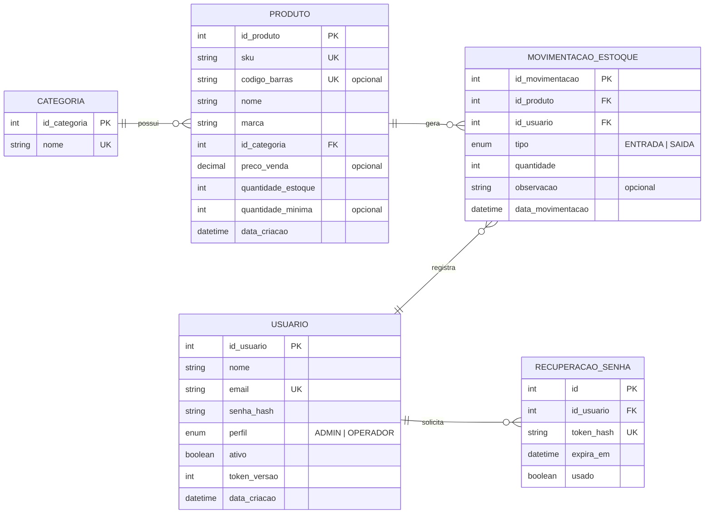

# Sistema de Gerenciamento de Estoque

API REST para controlar o estoque de um negócio: cadastro de produtos e categorias, entradas e saídas com histórico, alerta de estoque baixo e cadastro de produtos pelo código de barras usando a Open Food Facts.

**Stack:** Node.js 22, Express 5, MySQL 8.4, JWT, bcrypt, Nodemailer + Mailpit, Docker Compose.

## Sumário

1. [Sobre o sistema](#1-sobre-o-sistema)
2. [Entidades e DER](#2-entidades-e-der)
3. [Regras de negócio](#3-regras-de-negócio)
4. [Perfis e permissões](#4-perfis-e-permissões)
5. [Arquitetura](#5-arquitetura)
6. [Integração externa: Open Food Facts](#6-integração-externa-open-food-facts)
7. [Como executar](#7-como-executar)
8. [Collection do Postman](#8-collection-do-postman)
9. [Endpoints](#9-endpoints)
10. [Formato de erros](#10-formato-de-erros)

---

## 1. Sobre o sistema

Muitos negócios pequenos ainda controlam o estoque no papel ou em planilhas, o que gera erros de contagem e não registra quem retirou ou repôs cada item. Este sistema mantém o cadastro dos produtos e a quantidade disponível de cada um, e registra cada entrada e saída com data e responsável.

**Público-alvo:** donos de negócios e equipes que precisam acompanhar produtos para venda ou uso interno.

**Escopo:**
- cadastro de categorias e produtos (com pesquisa e filtros);
- entradas e saídas de estoque com histórico imutável;
- identificação de produtos sem estoque e com estoque baixo;
- usuários com dois perfis (Administrador e Operador), login com JWT e recuperação de senha por e-mail;
- cadastro de produto a partir do código de barras (Open Food Facts).

## 2. Entidades e DER

| Entidade | Descrição |
|---|---|
| **Usuário** | Pessoa que acessa o sistema. Perfil `ADMIN` ou `OPERADOR`. É o responsável por cada movimentação. |
| **Categoria** | Agrupa produtos (ex.: Bebidas, Limpeza). |
| **Produto** | Item controlado no estoque, identificado por um SKU único e, opcionalmente, pelo código de barras. |
| **Movimentação de estoque** | Entrada ou saída de um produto, com quantidade, data, observação e o usuário que a registrou. |

A tabela `recuperacao_senha` é auxiliar: guarda o hash dos códigos de recuperação de senha e não é uma entidade de negócio.



## 3. Regras de negócio

**Categorias**
- O nome é obrigatório e único.
- Uma categoria que possui produtos não pode ser excluída (409).

**Produtos**
- SKU obrigatório e único. Código de barras opcional, com 8 a 14 dígitos e único.
- Todo produto pertence a exatamente uma categoria existente.
- Preço de venda e quantidade mínima são opcionais e não podem ser negativos.
- Um produto cadastrado com estoque inicial maior que zero gera automaticamente uma movimentação de **ENTRADA** ("Estoque inicial").
- A quantidade em estoque **não pode ser editada diretamente**: ela só muda por movimentações.
- `disponivel` (estoque > 0) e `estoque_baixo` (quantidade mínima definida e estoque menor ou igual a ela) são calculados a cada consulta, não armazenados.
- Ao excluir um produto, suas movimentações também são excluídas.

**Movimentações de estoque**
- Entradas somam e saídas subtraem do estoque. A quantidade deve ser um inteiro maior que zero.
- O estoque nunca fica negativo. Uma saída maior que o disponível é recusada (409), e a resposta informa a quantidade máxima disponível.
- A atualização do estoque e o registro da movimentação ocorrem na mesma transação, com bloqueio da linha do produto, para que saídas simultâneas não deixem o saldo negativo.
- Toda movimentação registra o usuário responsável.

**Usuários e acesso**
- Apenas administradores cadastram usuários. O primeiro administrador é criado automaticamente na inicialização a partir das variáveis `ADMIN_*` do `.env`.
- O e-mail é único. A senha tem no mínimo 8 caracteres e é armazenada com bcrypt.
- A exclusão de usuário é **lógica** (desativação): a conta perde o acesso imediatamente, mas o registro permanece para preservar o histórico de movimentações.
- O último administrador ativo não pode ser rebaixado nem desativado.
- Trocar ou redefinir a senha invalida todos os tokens emitidos antes da troca.

**Recuperação de senha**
- O código é aleatório (256 bits), enviado por e-mail, válido por 30 minutos e de uso único. No banco fica apenas o hash SHA-256.
- Solicitar um novo código invalida os anteriores.
- A resposta de `/esqueci-senha` é a mesma para e-mails cadastrados ou não.

**Operações que não existem, e por quê**
- **Editar ou excluir movimentação:** o histórico de estoque é um registro de auditoria. Um lançamento errado é corrigido com uma movimentação no sentido contrário, mantendo a rastreabilidade.
- **Excluir usuário fisicamente:** substituído pela desativação, para não apagar a autoria das movimentações.
- **Cadastro público de usuários:** é um sistema interno da empresa; contas são criadas pelo administrador.

## 4. Perfis e permissões

O perfil **OPERADOR** corresponde ao "Usuário Comum": quem trabalha no dia a dia, consultando e movimentando o estoque. O **ADMIN** gerencia o catálogo e os usuários.

| Recurso / ação | Sem login | OPERADOR | ADMIN |
|---|:-:|:-:|:-:|
| Login, esqueci a senha, redefinir senha | ✔ | ✔ | ✔ |
| Ver e editar o próprio perfil, trocar a própria senha | | ✔ | ✔ |
| Listar e consultar categorias e produtos, consultar código de barras | | ✔ | ✔ |
| Registrar entradas e saídas, consultar histórico | | ✔ | ✔ |
| Criar, editar e excluir categorias | | | ✔ |
| Criar, importar, editar e excluir produtos | | | ✔ |
| Cadastrar, listar, editar e desativar usuários | | | ✔ |

## 5. Arquitetura

O código é organizado em camadas, aplicando os princípios da Clean Architecture: as regras de negócio ficam isoladas da interface HTTP, do banco de dados e dos serviços externos.

```
src/
├── server.js        inicialização: conexão com o banco, admin inicial e middlewares globais
├── routes.js        rotas e middlewares de autenticação/permissão de cada uma
├── controllers/     interface HTTP: lê a requisição, chama o service e devolve a resposta
├── services/        regras de negócio e validação; erros da aplicação; integrações (e-mail, Open Food Facts)
├── repositories/    persistência: único lugar com SQL
├── middlewares/     autenticação, perfil ADMIN, limite de requisições e tratamento global de erros
└── database.js      pool de conexões do MySQL e função de transação
```

- **Controllers** não têm regra de negócio nem SQL; ficam com 2 ou 3 linhas por função.
- **Services** não conhecem `req`/`res` nem escrevem SQL. Sinalizam falhas lançando erros da aplicação (`ErroValidacao` 400, `ErroNaoAutenticado` 401, `ErroProibido` 403, `ErroNaoEncontrado` 404, `ErroConflito` 409, `ErroServicoExterno` 503).
- **Repositories** concentram o acesso ao MySQL. Trocar o banco afeta só essa camada.
- **Middleware global de erros** (`middlewares/tratarErros.js`) converte qualquer erro na resposta padrão `{ "erro": "..." }`. Erros inesperados retornam 500 com mensagem genérica e são registrados só no log do servidor.

**Segurança aplicada:** senhas com bcrypt; JWT HS256 com expiração de 8h; usuário revalidado no banco a cada requisição (desativação e troca de perfil valem na hora); invalidação de tokens após troca de senha; limite de tentativas em `/login` e na recuperação de senha; login com tempo constante (não revela e-mails cadastrados); headers de segurança com `helmet`; MySQL sem porta exposta no host; container da API sem root.

## 6. Integração externa: Open Food Facts

**Serviço:** [Open Food Facts](https://world.openfoodfacts.org), base pública e colaborativa de produtos identificados pelo código de barras (EAN/GTIN), com boa cobertura de alimentos, bebidas, higiene e limpeza vendidos no Brasil.

**Finalidade no sistema:** agilizar e padronizar o cadastro de produtos. Em vez de digitar nome e marca, o administrador informa o código de barras da embalagem e a API preenche esses dados. Isso reduz erros de digitação e cadastros duplicados, já que o código de barras também passa a ser único no sistema.

| Endpoint | O que faz |
|---|---|
| `GET /produtos/codigo-barras/:codigo` | Consulta o código na Open Food Facts e mostra nome, marca, imagem e se o produto já está cadastrado no estoque. |
| `POST /produtos/importar` | Cadastra o produto com nome e marca vindos da Open Food Facts. Os demais campos seguem as regras do cadastro manual. |

**Configuração:** nenhuma. A API é gratuita e não exige chave. O serviço é acessado em `https://world.openfoodfacts.org` (variável opcional `OPEN_FOOD_FACTS_URL`).

**Como verificar:** use os códigos `7894900011517` (Refrigerante Coca-Cola 2L) ou `7891000100103` (Leite Condensado Moça). O código `7896004000855` não existe na base e retorna 404. Se a Open Food Facts estiver fora do ar, a API responde 503 e o cadastro manual continua funcionando.

## 7. Como executar

### Pré-requisitos

- [Docker](https://docs.docker.com/get-docker/) com Docker Compose.
- Portas livres no computador: **3000** (API) e **8025** (Mailpit).

### Passo a passo

1. Clone o repositório e entre na pasta:
   ```bash
   git clone https://github.com/Salfis/Gerenciamento-de-Estoque.git
   cd Gerenciamento-de-Estoque
   ```
2. Crie o arquivo `.env` a partir do exemplo. Os valores do exemplo já funcionam para rodar localmente:
   ```bash
   cp .env.example .env
   ```
   No Windows (PowerShell): `Copy-Item .env.example .env`
3. Suba o ambiente:
   ```bash
   docker-compose up
   ```
   ou `docker compose up`. Na primeira execução as imagens são baixadas e o banco é criado, o que leva cerca de 1 minuto. A API está pronta quando o log mostrar `API aberta na porta 3000`.

### Endereços

| Serviço | Endereço |
|---|---|
| API | http://localhost:3000 |
| Mailpit (caixa de entrada dos e-mails de recuperação) | http://localhost:8025 |

### Acesso inicial

Na primeira subida, a API cria o administrador definido no `.env`:

| E-mail | Senha |
|---|---|
| `admin@estoque.com` | `Admin@12345` |

Os demais usuários são criados por esse administrador em `POST /usuarios`.

### Variáveis de ambiente

| Variável | Para que serve | Como preencher |
|---|---|---|
| `PORT` | Porta da API no computador | `3000`. Troque se a porta estiver ocupada (e ajuste `baseUrl` na collection). |
| `MYSQL_ROOT_PASSWORD` | Senha do root do MySQL | Qualquer senha. |
| `MYSQL_DATABASE` | Nome do banco | `estoque_db` |
| `MYSQL_USER` / `MYSQL_PASSWORD` | Usuário que a API usa no banco | Qualquer usuário (exceto `root`) e senha. |
| `JWT_SECRET` | Chave de assinatura dos tokens | Texto longo e aleatório. Para gerar: `node -e "console.log(require('crypto').randomBytes(64).toString('hex'))"` |
| `ADMIN_NOME` / `ADMIN_EMAIL` / `ADMIN_SENHA` | Primeiro administrador, criado se ainda não houver nenhum | E-mail válido e senha de no mínimo 8 caracteres. |

As variáveis de conexão com o banco (`DB_HOST`, `DB_PORT`) e com o e-mail (`SMTP_HOST`, `SMTP_PORT`) são definidas pelo `docker-compose.yml` e não precisam estar no `.env`.

### Comandos úteis

| Comando | Efeito |
|---|---|
| `docker compose down` | Para os containers (os dados são mantidos). |
| `docker compose down -v` | Para os containers e **apaga o banco**. Na próxima subida o schema e o admin inicial são recriados. |
| `docker compose up --build` | Sobe recompilando a imagem da API após alterações no código. |
| `docker logs estoque_api` | Mostra o log da API. |

## 8. Collection do Postman

**Arquivo:** [`postman/Gerenciamento-de-Estoque.postman_collection.json`](postman/Gerenciamento-de-Estoque.postman_collection.json), com 46 requisições que cobrem todos os endpoints e os fluxos de autenticação e recuperação de senha.

**Como importar:** no Postman, clique em **Import** e selecione o arquivo.

**Configuração:** nenhuma, se a API estiver na porta 3000. As variáveis ficam na própria collection (aba **Variables**):

| Variável | Valor padrão |
|---|---|
| `baseUrl` | `http://localhost:3000` |
| `mailpitUrl` | `http://localhost:8025` |
| `adminEmail` / `adminSenha` | Os mesmos do `.env.example` |
| `tokenAdmin`, `tokenOperador`, `idCategoria`, `idProduto`, `codigoRecuperacao`... | Preenchidas automaticamente pelos scripts das requisições |

**Como usar:** execute as pastas na ordem, de 1 a 9, ou a collection inteira pelo **Run collection**. Cada requisição confere o status esperado e salva os tokens e ids para as seguintes. Na pasta **8. Recuperação de senha**, a requisição "Ler código no Mailpit" busca o e-mail recebido e extrai o código automaticamente. Também é possível abrir http://localhost:8025 e copiar o código manualmente. A pasta **9. Exclusões** remove o que foi criado, então a collection pode ser executada várias vezes.

## 9. Endpoints

Rotas protegidas exigem o header `Authorization: Bearer <token>`, obtido em `POST /login`. Corpos de requisição em JSON.

### Autenticação

#### `POST /login`: público
Obrigatórios: `email`, `senha`.
```json
{ "email": "admin@estoque.com", "senha": "Admin@12345" }
```
`200`
```json
{ "id_usuario": 1, "nome": "Administrador", "email": "admin@estoque.com", "perfil": "ADMIN", "token": "eyJhbGciOi..." }
```
Erros: `400` dados inválidos, `401` e-mail ou senha inválidos (ou usuário desativado), `429` excesso de tentativas.

#### `POST /esqueci-senha`: público
Obrigatório: `email`. Envia o código de recuperação para o e-mail, se ele estiver cadastrado.
```json
{ "email": "operador@estoque.com" }
```
`200`
```json
{ "mensagem": "Se o e-mail estiver cadastrado, você receberá as instruções." }
```

#### `POST /redefinir-senha`: público
Obrigatórios: `token` (código recebido por e-mail), `novaSenha` (mínimo 8 caracteres).
```json
{ "token": "9f2c...64 caracteres", "novaSenha": "NovaSenha@123" }
```
`200` `{ "mensagem": "Senha redefinida com sucesso." }`. Erro: `400` código inválido, expirado ou já usado.

### Usuários

| Método e caminho | Permissão | Corpo |
|---|---|---|
| `GET /usuarios/me` | autenticado | |
| `PATCH /usuarios/me` | autenticado | opcionais: `nome`, `email` (ao menos um) |
| `PATCH /usuarios/me/senha` | autenticado | obrigatórios: `senhaAtual`, `novaSenha` |
| `POST /usuarios` | ADMIN | obrigatórios: `nome`, `email`, `senha`; opcional: `perfil` (`OPERADOR` padrão, ou `ADMIN`) |
| `GET /usuarios` | ADMIN | |
| `GET /usuarios/:id` | ADMIN | |
| `PATCH /usuarios/:id` | ADMIN | opcionais: `nome`, `email`, `perfil`, `ativo` (ao menos um) |
| `DELETE /usuarios/:id` | ADMIN | desativa o usuário; `204` |

Exemplo: `POST /usuarios`
```json
{ "nome": "Maria Souza", "email": "maria@estoque.com", "senha": "Operador@123", "perfil": "OPERADOR" }
```
`201`
```json
{ "id_usuario": 2, "nome": "Maria Souza", "email": "maria@estoque.com", "perfil": "OPERADOR", "ativo": true, "data_criacao": "2026-11-08T22:35:14.000Z" }
```
Erros: `400` dados inválidos ou senha com menos de 8 caracteres, `409` e-mail já cadastrado ou tentativa de rebaixar/desativar o último administrador. `PATCH /usuarios/me/senha` retorna `401` se a senha atual estiver errada; após a troca, o token atual deixa de valer e é preciso fazer login de novo.

### Categorias

| Método e caminho | Permissão | Corpo |
|---|---|---|
| `GET /categorias` | autenticado | |
| `GET /categorias/:id` | autenticado | |
| `POST /categorias` | ADMIN | obrigatório: `nome` |
| `PUT /categorias/:id` | ADMIN | obrigatório: `nome` |
| `DELETE /categorias/:id` | ADMIN | `204` |

Exemplo: `POST /categorias` com `{ "nome": "Bebidas" }`. Resposta `201`: `{ "id_categoria": 1, "nome": "Bebidas" }`.
Erros: `400` nome ausente, `404` categoria não encontrada, `409` nome duplicado ou categoria com produtos (na exclusão).

### Produtos

| Método e caminho | Permissão | Corpo / parâmetros |
|---|---|---|
| `GET /produtos` | autenticado | query opcionais: `busca` (nome, marca, SKU ou código de barras), `id_categoria`, `disponivel` (`true`/`false`), `estoque_baixo` (`true`) |
| `GET /produtos/:id` | autenticado | |
| `POST /produtos` | ADMIN | obrigatórios: `sku`, `nome`, `marca`, `id_categoria`; opcionais: `codigo_barras`, `preco_venda`, `quantidade_estoque` (padrão 0), `quantidade_minima` |
| `PATCH /produtos/:id` | ADMIN | opcionais: `sku`, `codigo_barras`, `nome`, `marca`, `id_categoria`, `preco_venda`, `quantidade_minima` (ao menos um; `null` limpa os opcionais). `quantidade_estoque` é recusado. |
| `DELETE /produtos/:id` | ADMIN | `204`; exclui também as movimentações do produto |
| `GET /produtos/codigo-barras/:codigo` | autenticado | consulta na Open Food Facts |
| `POST /produtos/importar` | ADMIN | obrigatórios: `codigo_barras`, `id_categoria`; opcionais: `sku` (padrão: o código de barras), `nome`, `marca`, `preco_venda`, `quantidade_estoque`, `quantidade_minima` |

Exemplo: `POST /produtos`
```json
{ "sku": "REFRI-GUA-2L", "nome": "Refrigerante Guaraná 2L", "marca": "Antarctica", "id_categoria": 1, "preco_venda": 8.99, "quantidade_estoque": 20, "quantidade_minima": 5 }
```
`201`
```json
{
  "id_produto": 1, "sku": "REFRI-GUA-2L", "codigo_barras": null, "nome": "Refrigerante Guaraná 2L", "marca": "Antarctica",
  "id_categoria": 1, "categoria": "Bebidas", "preco_venda": 8.99, "quantidade_estoque": 20, "quantidade_minima": 5,
  "data_criacao": "2026-11-08T22:35:14.000Z", "disponivel": true, "estoque_baixo": false
}
```

Exemplo: `GET /produtos/codigo-barras/7894900011517`, resposta `200`:
```json
{ "codigo_barras": "7894900011517", "nome": "Refrigerante Coca-Cola 2Lt", "marca": "Coca-Cola", "imagem_url": "https://images.openfoodfacts.org/...jpg", "ja_cadastrado": false, "id_produto": null }
```

Exemplo: `POST /produtos/importar`
```json
{ "codigo_barras": "7894900011517", "id_categoria": 1, "preco_venda": 12.5, "quantidade_estoque": 6, "quantidade_minima": 2 }
```
`201`: o produto criado, no mesmo formato de `POST /produtos`, com `nome` e `marca` vindos da Open Food Facts.

Erros: `400` dados inválidos ou tentativa de alterar estoque pelo PATCH, `404` produto/categoria não encontrado ou código inexistente na Open Food Facts, `409` SKU ou código de barras duplicado, `503` Open Food Facts indisponível.

### Movimentações de estoque

| Método e caminho | Permissão | Corpo / parâmetros |
|---|---|---|
| `POST /movimentacoes` | autenticado | obrigatórios: `id_produto`, `tipo` (`ENTRADA`/`SAIDA`), `quantidade` (inteiro > 0); opcional: `observacao` |
| `GET /movimentacoes` | autenticado | query opcionais: `id_produto`, `tipo` |
| `GET /produtos/:id/movimentacoes` | autenticado | histórico de um produto |

Exemplo: `POST /movimentacoes`
```json
{ "id_produto": 1, "tipo": "SAIDA", "quantidade": 8, "observacao": "Venda balcão" }
```
`201`
```json
{ "id_movimentacao": 2, "id_produto": 1, "tipo": "SAIDA", "quantidade": 8, "observacao": "Venda balcão", "id_usuario": 2, "quantidade_estoque": 12 }
```
Saída maior que o estoque, `409`:
```json
{ "erro": "Estoque insuficiente. A quantidade máxima disponível para saída é 12", "quantidade_disponivel": 12 }
```
`GET /movimentacoes`, resposta `200`, das mais recentes para as mais antigas:
```json
[
  { "id_movimentacao": 2, "id_produto": 1, "produto": "Refrigerante Guaraná 2L", "sku": "REFRI-GUA-2L", "tipo": "SAIDA", "quantidade": 8,
    "observacao": "Venda balcão", "id_usuario": 2, "usuario": "Maria Souza", "data_movimentacao": "2026-11-08T22:40:02.000Z" }
]
```

## 10. Formato de erros

Todas as falhas retornam JSON no formato `{ "erro": "mensagem" }`, às vezes com campos extras (como `quantidade_disponivel`).

| Status | Quando |
|---|---|
| `400` | Campo obrigatório ausente, tipo inválido, JSON malformado, id inválido |
| `401` | Token ausente, inválido, expirado ou invalidado; credenciais incorretas |
| `403` | Usuário sem o perfil necessário |
| `404` | Recurso ou rota inexistente |
| `409` | Conflito com regra de negócio (duplicidade, estoque insuficiente, categoria com produtos, último administrador) |
| `429` | Excesso de tentativas de login ou de recuperação de senha |
| `500` | Erro inesperado (mensagem genérica; detalhes apenas no log) |
| `503` | Open Food Facts indisponível |
