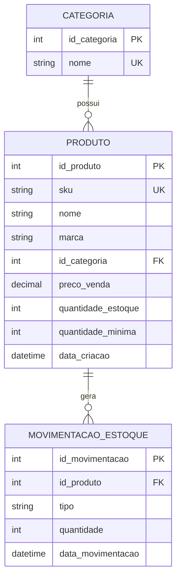

# Sistema de Gerenciamento de Estoque

## Sobre o projeto

Este projeto tem como objetivo desenvolver o backend de um sistema de gerenciamento de estoque.

O sistema busca resolver o problema da falta de acompanhamento de estoque para produtos de um negócio, evitando que esse controle seja feito de forma manual ou analógica, o que pode gerar erros de contagem e dificultar a consulta das informações.

A proposta é permitir o cadastro, consulta e atualização de produtos de maneira digital e fácil, mantendo o controle da quantidade disponível em estoque e registrando as alterações realizadas.

## Objetivo

O objetivo do sistema é disponibilizar uma base para o gerenciamento de estoque de um negócio, permitindo o cadastro e a consulta de produtos, o controle de preços e o acompanhamento das entradas e saídas do estoque.

O sistema também deve facilitar a identificação de produtos disponíveis, indisponíveis ou com estoque baixo.

## Público-alvo

O público-alvo do sistema são donos de negócios ou serviços que precisem acompanhar a disponibilidade de produtos em estoque e manter um cadastro organizado desses produtos, seja para venda ou para uso interno dentro da empresa.

## Funcionalidades principais

### Produtos

O sistema deve permitir:

- Cadastrar produtos;
- Consultar produtos;
- Editar informações de produtos cadastrados;
- Pesquisar produtos;
- Filtrar produtos por categoria;
- Filtrar produtos disponíveis e indisponíveis.

Cada produto poderá possuir informações como:

- Nome;
- Marca;
- Categoria;
- Preço de venda, quando aplicável (opcional);
- SKU;
- Quantidade em estoque;
- Quantidade mínima para aviso de estoque baixo, quando o alerta estiver configurado (opcional).
- Data de criação.

O SKU será utilizado como identificador único do produto, evitando o cadastro duplicado de um mesmo item.

### Categorias

Os produtos poderão ser separados em categorias para facilitar sua organização e consulta.
Cada produto deverá pertencer a uma única categoria.

O sistema deve permitir:

- Cadastrar categorias;
- Consultar categorias;
- Relacionar produtos a uma categoria.

### Controle de estoque

O sistema deve permitir:

- Adicionar unidades ao estoque;
- Remover unidades do estoque;
- Consultar a quantidade atual de um produto;
- Consultar o histórico de entradas e saídas;
- Identificar produtos sem estoque;
- Identificar produtos com estoque abaixo da quantidade mínima definida.

A quantidade em estoque nunca poderá ficar negativa.

Caso seja feita uma tentativa de saída maior que a quantidade disponível, a operação deverá ser recusada e o sistema deverá informar a quantidade máxima disponível naquele momento.

### Histórico de movimentações

Toda alteração na quantidade de um produto deverá gerar uma movimentação de estoque.

Uma movimentação poderá representar:

- Entrada de produtos;
- Saída de produtos;
- A data em que ocorreu a movimentação.

Caso um produto seja cadastrado com estoque inicial maior que zero,
essa quantidade deverá gerar automaticamente uma movimentação de entrada.

Cada movimentação deverá registrar o produto relacionado, o tipo da movimentação, a quantidade movimentada e a data em que a movimentação ocorreu.
Isso permite manter um histórico das alterações realizadas e entender como a quantidade atual de um produto foi alcançada.

## Regras de negócio iniciais

- Não deve ser permitido cadastrar dois produtos com o mesmo SKU;
- Não deve ser permitido cadastrar duas categorias com o mesmo nome;
- O estoque inicial de um produto pode ser igual a zero;
- Caso um produto seja cadastrado com estoque inicial maior que zero, essa quantidade deverá ser registrada no histórico;
- Entradas aumentam a quantidade disponível em estoque;
- Saídas diminuem a quantidade disponível em estoque;
- Não deve ser possível realizar uma saída maior que o estoque disponível;
- O estoque de um produto nunca pode ficar negativo;
- Toda alteração de estoque deve gerar um registro no histórico;
- A disponibilidade do produto pode ser determinada pela quantidade em estoque, sem necessidade de armazenar essa informação separadamente;
- Caso o produto possua um limite mínimo definido, produtos com quantidade menor ou igual a esse limite deverão ser identificados como produtos com estoque baixo.
- Ao excluir um produto, suas movimentações de estoque também deverão ser excluídas.

## Modelagem

As principais entidades do sistema são:

- Produto;
- Categoria;
- Movimentação de Estoque.

Os relacionamentos entre as entidades estão representados no DER abaixo:

### Diagrama Entidade-Relacionamento

## Executando o projeto

### Requisitos

- Docker
- Docker Compose

### Configuração

Crie um arquivo `.env` baseado no `.env.example`.

### Executando

docker compose up --build -d

A API estará disponível em:

http://localhost:3000